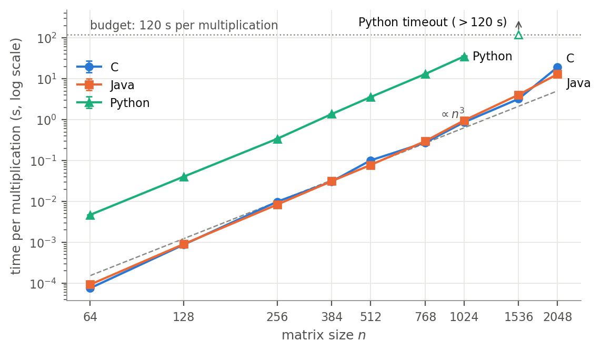

# Assignment 1 — Basic Matrix Multiplication in Python, Java and C

BIG DATA · GCID · ULPGC · 2026-2027 — Máximo Prosperi Reynoso

Empirical comparison of the same straightforward triple-loop dense matrix
multiplication (i-j-k order, scalar accumulator, IEEE-754 double, one thread, no
library calls) implemented in Python, Java and C. The study measures how the
matrix size n affects kernel runtime and peak memory on one fixed machine, under
a common protocol that was declared before any benchmark was run.

## Results at a glance

Session `20261014-225910`, Apple M4 MacBook Air. Median of five measured samples
per configuration, plus the peak resident set size of the process. These numbers
come from one machine and one session. The [report](report/main.pdf) discusses their variability,
growth and limits.

| n | C time | Java time | Python time | C peak RSS | Java peak RSS | Python peak RSS |
|---:|---:|---:|---:|---:|---:|---:|
| 256 | 9.84 ms | 8.36 ms | 340 ms | 2.9 MiB | 46.0 MiB | 21.0 MiB |
| 1024 | 861 ms | 954 ms | 35.1 s | 25.4 MiB | 69.1 MiB | 134 MiB |
| 2048 | 19.1 s | 12.9 s | — (timeout at n = 1536) | 97.4 MiB | 143 MiB | — |



All three implementations produced bitwise-identical results at every size they
completed. Python exceeded the 120 s per-multiplication budget at n = 1536, so the
largest size it completed is n = 1024.

## Repository layout

```
assignment1/
├── c/                 C implementation
│   ├── src/           matmul.c (kernel), matmul.h, main.c (benchmark driver)
│   ├── tests/         test_matmul.c
│   └── Makefile       make | make test | make asm
├── java/              Java implementation (standalone Maven project)
│   └── src/           org.ulpgc.bd.matmul.{MatMul, Main} and JUnit 5 tests
├── python/            Python implementation (standard library only)
│   ├── matmul.py      kernel and I/O
│   ├── main.py        benchmark driver
│   └── tests/         pytest suite
├── config/bench.json  declared experimental protocol (single source of truth)
├── scripts/
│   ├── gen_inputs.py      seeded input matrices + SHA-256 check
│   ├── verify.py          cross-language correctness verification
│   ├── run_benchmarks.py  benchmark harness (time budget, peak RSS, environment)
│   ├── collect_env.sh     environment snapshot
│   └── common.py          shared helpers (build, command lines, tolerance)
├── data/
│   ├── checksums.sha256   digests of the generated inputs
│   └── inputs/            generated A_<n>.bin, B_<n>.bin (not tracked)
├── results/
│   ├── correctness.csv    output of verify.py
│   └── raw/<session>/     raw benchmark data of one session
├── analysis/
│   ├── analyze.py         summary statistics, tables and figures
│   ├── tables/            CSV summaries and LaTeX tables used by the report
│   └── figures/           figures (PDF for the report, PNG for viewing)
├── report/            main.tex (LaTeX source of the research report) and main.pdf
├── CHECKLIST.md       each course requirement mapped to where it is met
└── requirements.txt   Python packages for the scripts, tests and analysis
```

## Requirements

The results were produced with exactly this software, on this machine:

| Component | Version used |
|---|---|
| Machine | MacBook Air (Mac16,13), Apple M4 (4 performance + 6 efficiency cores), 24 GB RAM |
| Operating system | macOS 26.6.2 (build 25G83) |
| C compiler | Apple clang 21.0.0 (clang-2100.3.34.2), GNU Make |
| Java | OpenJDK 25.0.2 (Homebrew build, HotSpot), Apache Maven 3.9.12 |
| Python | CPython 3.13.9 (Anaconda build; no JIT, GIL enabled) |
| Python packages | numpy 2.3.5, pandas 2.3.3, matplotlib 3.10.6, pytest 8.4.2 (`requirements.txt`) |

Install the Python packages into the interpreter you will use:

```sh
python3 -m pip install -r requirements.txt
```

Notes:

- The Python matrix multiplication uses only the standard library. NumPy is used
  to generate the inputs and as the correctness reference, and is never imported
  by a benchmark process.
- `verify.py` and `run_benchmarks.py` run the Python implementation with the same
  interpreter that runs them (`sys.executable`). The interpreter you launch the
  harness with is therefore the one that gets measured.
- The implementations and their tests are portable. The harness and the
  environment snapshot rely on macOS tools: `/usr/bin/time -l` for peak RSS,
  `sysctl` and `pmset`.

## Reproducing the study

Run every command from `assignment1/`. The Java and C drivers resolve their
default input paths relative to the working directory.

```sh
cd assignment1

# 1. Inputs: about 1 s, 133 MB in data/inputs/, checked against data/checksums.sha256
python3 scripts/gen_inputs.py

# 2. Unit tests (each command also builds the implementation)
python3 -m pytest python/tests          # 16 tests
mvn -f java/pom.xml package             # 17 tests, builds java/target/matmul.jar
make -C c test                          # 36 checks, builds c/build/matmul

# 3. Cross-language correctness: about 4 s, writes results/correctness.csv
python3 scripts/verify.py

# 4. Benchmarks: about 15 min, writes results/raw/<YYYYMMDD-HHMMSS>/
python3 scripts/run_benchmarks.py

# 5. Tables and figures from the most recent session
python3 analysis/analyze.py
```

What each step does:

1. **`gen_inputs.py`** draws every A and B from
   `numpy.random.Generator(PCG64(SeedSequence([2026, n])))`, uniform on [-1, 1),
   and stores them as raw little-endian float64 in row-major order. NumPy does not
   promise the same random stream across versions, so the script compares every
   file with `data/checksums.sha256` and reports any mismatch. Use
   `python3 scripts/gen_inputs.py --check` to verify existing files without
   regenerating them.
2. **The unit tests** check hand-computed 2×2 and 3×3 products, identity and zero
   matrices, a reference result (exact BigDecimal in Java, exact int64 in C,
   NumPy within the declared tolerance in Python), the binary I/O and the common
   command-line contract of each driver.
3. **`verify.py`** runs each implementation through its normal command line for
   n ∈ {1, 2, 3, 10, 64, 100, 256} and three cases: random inputs (reference:
   `numpy.matmul`), A·I (exact answer: A) and A·0 (exact answer: 0). The criterion
   is |C − R| ≤ 2γₙ(|A||B|) elementwise, with γₙ = nu/(1 − nu) and u = 2⁻⁵³. The
   script also checks whether the three outputs are bitwise identical, and exits
   with status 1 on any failure.
4. **`run_benchmarks.py`** first builds C and Java with the flags from
   `config/bench.json`. It then runs one fresh process per (language, n) under
   `/usr/bin/time -l`, with n ascending and the languages in the order C, Java,
   Python, separated by 2 s pauses. Each process performs the warm-up and measured
   samples itself and prints them as CSV. When a process exceeds the time budget,
   the harness kills it, records a timeout and skips the larger sizes for that
   language. The reference session took 13.3 min.
5. **`analyze.py`** summarises only the measured samples (warm-ups are excluded)
   and writes `analysis/tables/` and `analysis/figures/`. Pass
   `--session <name>` to analyse a session other than the most recent one. Run on
   the tracked raw data, it reproduces the committed tables and figures byte for
   byte.

Useful options for quick checks. Sessions whose name starts with `smoke` are not
tracked by git, and `analyze.py` ignores them.

```sh
python3 scripts/run_benchmarks.py --sizes 1 64 128 --reps 2 --session smoke    # about 30 s
python3 scripts/run_benchmarks.py --languages c java --sizes 256 512 --session smoke-cj
python3 scripts/run_benchmarks.py --max-seconds 1 --sizes 512 1024 --session smoke-timeout
python3 scripts/verify.py --sizes 1 2 3
```

## Building the report

The report reads its tables and figures directly from `analysis/tables/` and
`analysis/figures/`, so it always shows the output of the last analysis run. It
was built with Tectonic 0.17.0, which downloads the LaTeX packages it needs on
first use:

```sh
cd report
tectonic -X compile main.tex            # writes report/main.pdf
```

## Running one implementation by hand

The three drivers share one command-line contract. All of them read
`data/inputs/A_<n>.bin` and `B_<n>.bin` unless `--a` / `--b` are given:

```sh
c/build/matmul                          --n 512 --warmup 1 --reps 5
java -Xmx4g -jar java/target/matmul.jar --n 512 --warmup 2 --reps 5
python3 -u python/main.py               --n 512 --warmup 1 --reps 5
```

| Option | Meaning (default) |
|---|---|
| `--n N` | matrix side length (required) |
| `--a PATH`, `--b PATH` | input files (`data/inputs/A_<n>.bin`, `B_<n>.bin`) |
| `--warmup W` | minimum number of warm-up samples (C and Python: 1, Java: 2) |
| `--min-warmup-seconds SW` | warm-up continues until at least SW s of warm-up work has run (1.0) |
| `--reps R` | measured samples (5) |
| `--min-sample-seconds S` | each sample repeats the multiplication until it lasts about S s (0.1) |
| `--out PATH` | write C as raw little-endian float64 after the last sample |

Each driver prints CSV on stdout. This excerpt is from the Java run for n = 256 in
the reported session:

```
kind,index,batch,elapsed_ns,checksum
warmup,0,1,13915167,1441.9909292877212
warmup,1,8,73355333,1441.9909292877212
...
measure,4,13,108517250,1441.9909292877212
```

- `kind` is `warmup` or `measure`.
- `batch` is the number of back-to-back multiplications timed in that sample, so
  the time per multiplication is `elapsed_ns / batch`.
- Only the kernel is inside the timed region. Loading the inputs, allocating the
  output and starting the runtime are outside it.
- `checksum` is the sum of all entries of C, printed with 17 significant digits.
  Printing it stops the compiler or JIT from discarding the computation.

## Experimental protocol

The full protocol is in [`config/bench.json`](config/bench.json): research
question, hypotheses H1–H4, algorithm and storage layouts, inputs, sizes, timer
boundary, warm-up and repetitions, budgets, memory metric, correctness tolerance,
and the fixed compiler, JVM and Python settings. The scripts read that file, so it
cannot drift from the code. In short:

| Item | Setting |
|---|---|
| Benchmark sizes | 64, 128, 256, 384, 512, 768, 1024, 1536, 2048 (plus n = 1 as the memory baseline) |
| Storage | Python list of lists; Java `double[][]`; C one contiguous row-major `malloc` block |
| C build | `clang -std=c17 -O2 -ffp-contract=off -Wall -Wextra` (no FMA, no `-ffast-math`, no `-march`) |
| JVM | `java -Xmx4g` (default G1 GC and tiered JIT) |
| Python | `python3 -u` (CPython, no JIT) |
| Clocks | `perf_counter_ns` / `System.nanoTime` / `clock_gettime(CLOCK_MONOTONIC_RAW)` |
| Warm-up | at least 1 (Python, C) or 2 (Java) samples and at least 1 s of warm-up work |
| Measurement | 5 samples per configuration, each about 0.1 s or one multiplication; median and IQR |
| Time budget | 120 s per multiplication; a timeout skips larger n for that language |
| Memory | peak RSS of the whole process from `/usr/bin/time -l`, compared with 24n² bytes |

Two protocol rules were amended after smoke tests and before the reported
session. The batch size is now re-calibrated on every warm-up sample, because the
JIT left Java batches too small (commit `58c80d3`). Warm-up now runs for at least
1 s, because the CPU frequency ramp of macOS slowed down the first samples (commit
`fd6fd3a`). The reasons are recorded in `config/bench.json` and in the commit
messages.

## Data and outputs

| Path | Content |
|---|---|
| `data/inputs/` | generated inputs (not tracked; regenerate with step 1) |
| `data/checksums.sha256` | SHA-256 of all 28 input files |
| `results/correctness.csv` | one row per (case, n, language): max error, error/bound ratio, pass, bitwise agreement |
| `results/raw/20261014-225910/samples.csv` | every sample of the reported session, warm-ups included |
| `results/raw/20261014-225910/runs.csv` | one row per process: status (`ok` / `timeout` / `skipped`), peak RSS, peak footprint, process times, instructions and cycles from `/usr/bin/time -l`, exact command |
| `results/raw/20261014-225910/env.txt` | hardware, OS, power and thermal state, toolchain versions, effective JVM flags, before and after the session |
| `results/raw/20261014-225910/config.json` | copy of the protocol used by the session |
| `analysis/tables/summary.csv` | one row per (language, n) with all summary statistics at full precision |
| `analysis/tables/*.tex`, `analysis/figures/*.pdf` | the tables and figures included in the report |

When reading `samples.csv` yourself, parse the `checksum` column with Python's
`float()` or pass `float_precision="round_trip"` to pandas. The default pandas
parser can differ from the exact value in the last bit, which makes identical
checksums look different.

## Note on the project structure

The three language implementations live side by side in one project, inside a
repository that also holds the other three course assignments. This is **not**
the recommended practice for multi-language software — each implementation would
normally be its own project with its own build and dependency management. It is
done here only to keep the whole class submission (code, data, analysis and report)
together in one place.
