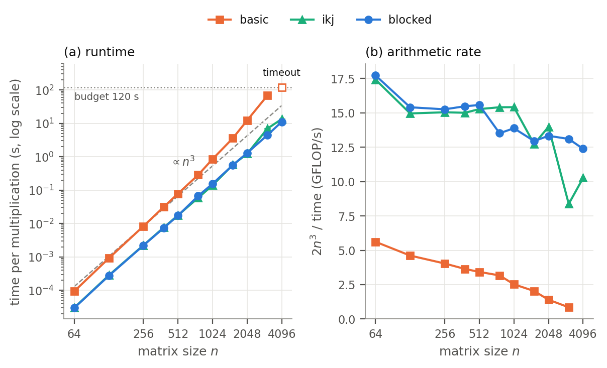
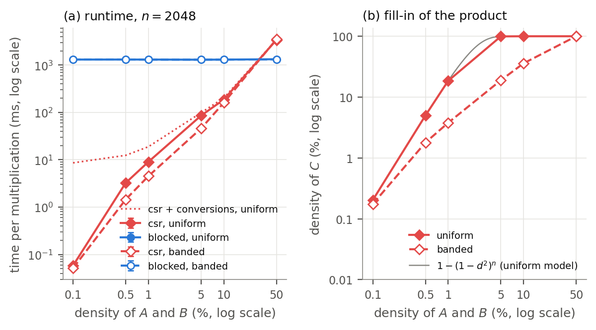

# Assignment 2 — Optimised Matrix Multiplication and Sparse Matrices

BIG DATA · GCID · ULPGC · 2026-2027 — Máximo Prosperi Reynoso

Empirical study in Java of two questions. **Part A:** how loop reordering (i-k-j)
and cache blocking change the runtime and memory of sequential dense matrix
multiplication, relative to the basic i-j-k triple loop of Assignment 1.
**Part B:** under which densities and nonzero structures a sparse product in
CSR format (Gustavson's algorithm) beats the optimised dense method on the
same logical matrices, and which costs (indexing, conversion, output) reduce
its advantage. Every method computes in IEEE-754 double on one thread, and all
of them produce bitwise-identical results.

## Results at a glance

Session `20261029-104152`, Apple M4 MacBook Air, Java 25, one thread. Median of
five measured samples per configuration. These numbers come from one machine and
one session. The [report](report/main.pdf) discusses their variability, causes and
limits.

**Part A — dense methods** (time per multiplication):

| n | basic | ikj | blocked (b = 512) | basic / ikj | ikj / blocked |
|---:|---:|---:|---:|---:|---:|
| 256 | 8.31 ms | 2.23 ms | 2.20 ms | 3.7 | 1.01 |
| 1024 | 850 ms | 139 ms | 155 ms | 6.1 | 0.90 |
| 2048 | 12.2 s | 1.23 s | 1.29 s | 10.0 | 0.95 |
| 3072 | 67.9 s | 6.93 s | 4.43 s | 9.8 | 1.57 |
| 4096 | timeout (> 120 s) | 13.4 s | 11.1 s | — | 1.21 |



**Part B — CSR product vs blocked at n = 2048** (kernel times; conversions are
measured separately in the report):

| density | structure | nnz(C) | csr | blocked | speed-up of csr |
|---:|---|---:|---:|---:|---:|
| 0.1 % | uniform | 8 545 | 0.058 ms | 1.31 s | 22 485 |
| 1 % | uniform | 776 282 (18.5 %) | 9.05 ms | 1.31 s | 145 |
| 1 % | banded | 158 681 (3.8 %) | 4.51 ms | 1.31 s | 289 |
| 10 % | uniform | 4 194 304 (100 %) | 187 ms | 1.31 s | 7.0 |
| 50 % | uniform | 4 194 304 (100 %) | 3.40 s | 1.33 s | 0.39 |



All methods, the sparse product included, produced bitwise-identical results.
At 1 % density (uniform), the largest size within the budgets is n = 8192 for
blocked (90.6 s; timeout at 16384) and n = 16384 for csr (3.8 s; out of the
8 GiB heap at 32768, where the product fills in).

## Repository layout

```
assignment2/
├── pom.xml                Maven build (standalone, Java 25, JUnit 5)
├── src/main/java/org/ulpgc/bd/matmul/
│   ├── DenseMatMul.java   basic (Assignment 1 kernel), ikj, blocked
│   ├── CsrMatrix.java     CSR storage, conversions, Gustavson product
│   ├── MatrixIO.java      dense (.bin) and CSR (.csr) file formats
│   └── Main.java          benchmark driver (one method per process)
├── src/test/java/...      JUnit 5 tests (45)
├── config/bench.json      declared experimental protocol (single source of truth)
├── scripts/
│   ├── gen_inputs.py      seeded dense and sparse inputs + SHA-256 check
│   ├── verify.py          correctness verification against NumPy/SciPy
│   ├── run_benchmarks.py  benchmark harness (time and heap budgets, peak RSS)
│   ├── collect_env.sh     environment snapshot
│   └── common.py          shared helpers (paths, command lines, file formats)
├── data/
│   ├── checksums.sha256   digests of the generated inputs
│   └── inputs/            generated inputs (not tracked)
├── results/
│   ├── correctness.csv    output of verify.py
│   └── raw/<session>/     raw benchmark data of one session
├── analysis/
│   ├── analyze.py         summary statistics, tables and figures
│   ├── tables/            CSV summaries and LaTeX tables used by the report
│   └── figures/           figures (PDF for the report, PNG for viewing)
├── report/                main.tex (LaTeX source of the research report) and main.pdf
├── CHECKLIST.md           each course requirement mapped to where it is met
└── requirements.txt       Python packages for the scripts and the analysis
```

## Requirements

The results were produced with exactly this software, on this machine:

| Component | Version used |
|---|---|
| Machine | MacBook Air (Mac16,13), Apple M4 (4 performance + 6 efficiency cores), 24 GB RAM |
| Operating system | macOS 26.6.2 (build 25G83) |
| Java | OpenJDK 25.0.2 (Homebrew build, HotSpot), Apache Maven 3.9.12 |
| Python | CPython 3.13.9 (Anaconda build) |
| Python packages | numpy 2.3.5, scipy 1.16.3, pandas 2.3.3, matplotlib 3.10.6 (`requirements.txt`) |

```sh
python3 -m pip install -r requirements.txt
```

The Java code uses no library outside the JDK (JUnit only for the tests).
NumPy generates the inputs, and NumPy and SciPy are the correctness references;
neither is ever loaded by a benchmark process. The harness and the environment
snapshot rely on macOS tools (`/usr/bin/time -l`, `sysctl`, `pmset`).

## Reproducing the study

Run every command from `assignment2/`.

```sh
cd assignment2

# 1. Inputs: a few seconds, about 1 GB in data/inputs/, checked against data/checksums.sha256
python3 scripts/gen_inputs.py

# 2. Unit tests (45) and build of target/matmul.jar
mvn package

# 3. Correctness of every method: about 15 s, writes results/correctness.csv
python3 scripts/verify.py

# 4. Benchmarks: about 45 min, writes results/raw/<YYYYMMDD-HHMMSS>/
python3 scripts/run_benchmarks.py

# 5. Tables and figures from the most recent session
python3 analysis/analyze.py
```

What each step does:

1. **`gen_inputs.py`** writes the dense inputs with the Assignment 1 generator,
   unchanged (`numpy.random.Generator(PCG64(SeedSequence([2026, n])))`, uniform
   on [-1, 1), raw little-endian float64). For the 14 sizes shared with
   Assignment 1 the files are byte-identical to Assignment 1's. The sparse inputs
   are CSR files with exactly round(d n²) nonzeros. In a *uniform* matrix every
   position is equally likely; in a *banded* one only positions with
   |i − j| ≤ ⌈d n⌉ are possible. Each matrix has its own seed,
   `SeedSequence([2026, n, structure, ppm, matrix])`. Every file is compared with
   `data/checksums.sha256`. `--check` verifies existing files without regenerating them.
2. **The unit tests** check hand-computed products, identity and zero
   matrices, an exact BigDecimal reference, sizes that are not multiples of the
   tile size, the bitwise equality of every method to `basic` (the sparse product
   included), the CSR conversions, empty rows, structural cancellation, the
   nonzero and multiply-add counts, the file formats and the driver contract.
3. **`verify.py`** runs every method through its command line on dense inputs
   (n = 1 … 256: random, A·I, A·0; reference `numpy.matmul`) and on sparse inputs
   (n = 1 … 256, densities 0 to 100 %, both structures; reference: the SciPy CSR
   product). The criterion is |C − R| ≤ 2γₙ(|A||B|) elementwise, as in
   Assignment 1. `csr` must store exactly the structural nonzero count of C, and
   all methods must agree bit for bit. Any failure gives exit status 1.
4. **`run_benchmarks.py`** builds the jar and runs one fresh JVM per configuration
   (experiment, method, input, tile size) under `/usr/bin/time -l`. It enforces
   60 s for start-up and 120 s per operation, records timeouts and out-of-memory
   failures (heap limit `-Xmx8g`), and skips larger sizes of a series after a
   failure. `--experiments`, `--max-n`, `--reps` and `--session smoke…` give
   quick checks (smoke sessions are not tracked).
5. **`analyze.py`** summarises only the measured samples (warm-ups excluded) and
   writes `analysis/tables/` and `analysis/figures/`. `--session <name>`
   selects another session.

## Methods

| Method | What changes | Expected effect |
|---|---|---|
| `basic` | nothing: the i-j-k loop with a scalar accumulator, copied from Assignment 1 (tag `assignment1-v1.0`) | baseline; walks a column of B |
| `ikj` | loop order i-k-j: adds A[i][k] × row k of B to row i of C | unit-stride access, independent iterations that the JIT can vectorise |
| `blocked` | the i-k-j loops split into b × b tiles (b = 512) | tiles reused while in cache |
| `csr` | CSR storage and Gustavson's two-pass row-by-row product | work ∝ multiply-adds and output size, not n³ |
| `to_csr`, `to_dense` | the conversions dense → CSR (A and B) and CSR → dense (C) | timed separately |

## Running one method by hand

```sh
java -Xmx8g -jar target/matmul.jar --method ikj --n 1024 \
     --a data/inputs/A_1024.bin --b data/inputs/B_1024.bin
java -Xmx8g -jar target/matmul.jar --method csr --n 2048 \
     --a data/inputs/sparse/uniform_2048_d1_A.csr --b data/inputs/sparse/uniform_2048_d1_B.csr
```

| Option | Meaning (default) |
|---|---|
| `--method M` | `basic`, `ikj`, `blocked`, `csr`, `to_csr` or `to_dense` (required) |
| `--n N` | matrix side length (required, checked against the files) |
| `--a PATH`, `--b PATH` | input files; `.csr` files are read as CSR, others as raw dense |
| `--block BS` | tile size of `blocked` (512) |
| `--pre-warm-seconds P` | JIT pre-warm on small random inputs before any sample (1.0) |
| `--warmup W` | minimum number of warm-up samples (1) |
| `--min-warmup-seconds SW` | warm-up continues until SW s of warm-up work have run (1.0) |
| `--reps R` | measured samples (5) |
| `--min-sample-seconds S` | each sample repeats the operation until it lasts about S s (0.1) |
| `--out PATH` | write C as raw little-endian float64 after the last sample |

The driver prints CSV on stdout with the Assignment 1 header
`kind,index,batch,elapsed_ns,checksum`, plus metadata lines starting with `#`
(`nnz_a`, `nnz_b`, `nnz_c`, `nnz_c_nonzero`, `multiply_adds`, pre-warm counts).
Only the operation is timed. Input loading, conversion to the method's
representation and the pre-warm are outside the timed region. Exit status 3
means the JVM ran out of heap.

## Experimental protocol

The full protocol is in [`config/bench.json`](config/bench.json): research
questions, hypotheses, methods with their expected effects, inputs, experiments,
timer boundary, conversion policy, pre-warm, warm-up and repetitions, budgets,
memory metrics and correctness tolerance. In short:

| Item | Setting |
|---|---|
| Experiments | A_dense (n = 64 … 4096), A_block (b = 32 … 512 at n = 2048, 4096), B_density (n = 2048, density 0.1–50 %, uniform and banded), B_size (uniform 1 %, n = 1024 … 32768) |
| JVM | `java -Xmx8g`, defaults otherwise (G1, tiered JIT, SuperWord on, 128-bit vectors) |
| Clock | `System.nanoTime()` |
| Pre-warm | 1 s on small random inputs, so that the JIT compiles the method with a full profile |
| Warm-up | at least 1 sample and 1 s of warm-up work |
| Measurement | 5 samples per configuration, each about 0.1 s or one operation; median and IQR |
| Conversions | excluded from the csr kernel time and measured separately (`to_csr`, `to_dense`) |
| Budgets | 120 s per operation, 8 GiB heap, 90 min per session; failures are results |
| Memory | peak RSS and peak footprint of the process (`/usr/bin/time -l`), and the element storage computed from the nonzero counts |

The pre-warm is new compared with Assignment 1. In a pilot, `ikj` at n = 2048
stayed in OSR- and C1-compiled code without it (3.3 s per multiplication instead
of 1.24 s), so the comparison would have measured the JIT rather than the method.

## Data and outputs

| Path | Content |
|---|---|
| `data/inputs/` | generated inputs (not tracked; regenerate with step 1) |
| `data/checksums.sha256` | SHA-256 of all input files |
| `results/correctness.csv` | one row per (case, method): max error, error/bound ratio, pass, bitwise agreement, nonzero counts |
| `results/raw/20261029-104152/samples.csv` | every sample of the reported session, warm-ups included |
| `results/raw/20261029-104152/runs.csv` | one row per process: status, nonzero counts, multiply-adds, peak RSS and footprint, process times, instructions and cycles, exact command |
| `results/raw/20261029-104152/env.txt` | hardware, OS, power and thermal state, JVM flags, Python packages, before and after the session |
| `results/raw/20261029-104152/config.json` | copy of the protocol used by the session |
| `analysis/tables/summary.csv` | one row per configuration with all summary statistics |
| `analysis/tables/*.tex`, `analysis/figures/*.pdf` | the tables and figures included in the report |

When reading `samples.csv` yourself, parse the `checksum` column with Python's
`float()` or pass `float_precision="round_trip"` to pandas, as in Assignment 1.

## Reuse of Assignment 1

The baseline kernel (`DenseMatMul.basic`), the dense input generator and its
files, the correctness tolerance, and the structure of the benchmark harness,
the verification script, the environment snapshot and the analysis script come
from Assignment 1 at the tag `assignment1-v1.0`. Each reused file says so in
its header.
