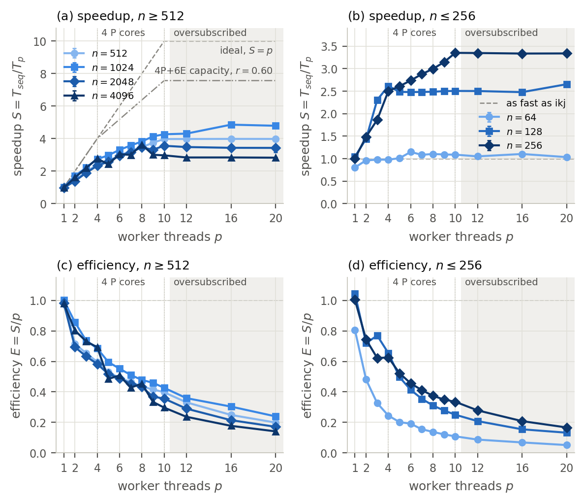

# Assignment 3 — Parallel Matrix Multiplication and SIMD Vectorisation

BIG DATA · GCID · ULPGC · 2026-2027 — Máximo Prosperi Reynoso

Empirical study in Java of how the number of threads changes the performance
of a shared-memory matrix multiplication, and of when parallel execution helps.
The sequential baseline is the validated i-k-j kernel of Assignment 2; the
parallel version computes the rows of C with the same loop on a fixed pool of
p worker threads (p = 1 … 20), with a dynamic or a static assignment of rows.
The machine is an Apple M4 with 4 performance and 6 efficiency cores. The
optional vectorisation extension compares the same code with the JIT's SIMD
vectoriser (SuperWord) on and off. Every configuration computes in IEEE-754
double and produces bitwise-identical results.

## Results at a glance

Session `20261104-030623`, Apple M4 MacBook Air (4 P + 6 E cores), Java 25:
167 configurations in 43 min, all completed, all bitwise identical. Median of
five measured samples per configuration. These numbers come from one machine and
one session. The [report](report/main.pdf) discusses their variability, causes
and limits.

**Speedup S = T(ikj) / T(par_ikj, dynamic rows)**:

| n | ikj | S, p = 1 | S, p = 4 | S, p = 10 | best S (p) |
|---:|---:|---:|---:|---:|---:|
| 64 | 0.030 ms | 0.81 | 0.98 | 1.09 | 1.15 (6) |
| 128 | 0.301 ms | 1.04 | 2.62 | 2.51 | 2.66 (20†) |
| 256 | 2.23 ms | 1.00 | 2.50 | 3.35 | 3.35 (10) |
| 512 | 17.4 ms | 1.00 | 2.39 | 3.98 | 3.99 (16†) |
| 1024 | 138 ms | 1.00 | 2.74 | 4.27 | 4.86 (16†) |
| 2048 | 1.17 s | 0.98 | 2.33 | 3.56 | 3.56 (10) |
| 4096 | 13.0 s | 0.98 | 2.77 | 2.97 | 3.63 (8) |

† oversubscribed: more worker threads than the 10 logical processors.



- **When it helps.** From n = 128 on. At n = 64 a multiplication lasts 30 µs:
  the best speedup is 1.15, and with one thread the parallel code is 24 %
  slower (about 7 µs per call to hand the rows to the pool).
- **Why 10 threads are about 4 times faster, not 10.** macOS runs four threads
  on the performance cores and every further thread on an efficiency core (the
  E-core share of CPU time is (p − 4)/p). An E core retires 0.46 to 0.64 times
  the instructions per second of a P core, the clock falls from 4.0 GHz to
  3.0–3.8 GHz on the P cores, and with four threads the cycles per
  multiply-add already rise by 11 to 50 % (shared L2 and memory).
- **Memory bandwidth.** At n = 4096 the kernel requests B at about 120 GB/s,
  the memory bandwidth of the M4, from p ≈ 4 on, and the speedup stays near 3.
- **Schedules.** Static row bands were up to 32 % faster than row-by-row dynamic
  assignment at n = 256 and 1024, most likely because adjacent rows written by
  different threads share cache lines; dynamic won only at n = 2048.
- **Oversubscription** (12–20 threads) cost at most 5 % and gained clearly only
  at n = 1024 (12–14 %; 6 % at n = 128 with 20 threads).
- **Vectorisation.** With SuperWord the compiled inner loop has 8 `fmul.2d` and
  8 `fadd.2d` (two doubles per instruction, no fused multiply-add); turning it
  off makes the kernel 1.16 to 1.51 times slower and raises the instructions per
  multiply-add by a factor of 1.7 to 2.0.
- **Memory.** Peak RSS does not depend on p at n ≥ 2048 (within 8 MiB); at
  n ≤ 128 it grows with p because every call allocates task objects.

## Repository layout

```
assignment3/
├── pom.xml                  Maven build (standalone, Java 25, JUnit 5)
├── src/main/java/org/ulpgc/bd/matmul/
│   ├── DenseMatMul.java     ikj, the sequential baseline (Assignment 2 kernel, unchanged)
│   ├── ParallelMatMul.java  par_ikj: row-parallel ikj on a fixed thread pool, dynamic or static rows
│   ├── ProcessCounters.java CPU time, P-core time, instructions, cycles, context switches (FFM, macOS)
│   ├── MatrixIO.java        dense file format of Assignments 1 and 2
│   └── Main.java            benchmark driver (one configuration per process)
├── src/test/java/...        JUnit 5 tests (32)
├── config/bench.json        declared experimental protocol (single source of truth)
├── scripts/
│   ├── gen_inputs.py        seeded inputs (Assignment 1 generator) + SHA-256 check
│   ├── verify.py            correctness of every configuration against NumPy, bitwise agreement
│   ├── run_benchmarks.py    benchmark harness (size blocks, cool-down, budgets, peak RSS, background CPU)
│   ├── simd_evidence.py     decodes the JIT-compiled kernels with SuperWord on and off
│   ├── collect_env.sh       environment snapshot
│   └── common.py            shared helpers (paths, command lines, file format, error bound)
├── data/
│   ├── checksums.sha256     digests of the generated inputs (identical to Assignment 2's)
│   └── inputs/              generated inputs (not tracked)
├── results/
│   ├── correctness.csv      output of verify.py
│   ├── simd/                decoded machine code of the kernels and instruction counts
│   └── raw/<session>/       raw benchmark data of one session
├── analysis/
│   ├── analyze.py           summary statistics, speedups, tables and figures
│   ├── tables/              CSV summaries and LaTeX tables used by the report
│   └── figures/             figures (PDF for the report, PNG for viewing)
├── report/                  main.tex (LaTeX source of the research report) and main.pdf
├── CHECKLIST.md             each course requirement mapped to where it is met
└── requirements.txt         Python packages for the scripts and the analysis
```

## Requirements

The results were produced with exactly this software, on this machine:

| Component | Version used |
|---|---|
| Machine | MacBook Air 15-inch, M4, 2025 (Mac16,13, fanless): 4 performance + 6 efficiency cores, 10 logical processors, 24 GB RAM, 120 GB/s memory bandwidth |
| Operating system | macOS 26.6.2 (build 25G83) |
| Java | OpenJDK 25.0.1 (build 25.0.1+8-27, HotSpot), Apache Maven 3.9.12 |
| Python | CPython 3.13.9 (Anaconda build) |
| Python packages | numpy 2.3.5, pandas 2.3.3, matplotlib 3.10.6, psutil 7.0.0 (`requirements.txt`) |
| Tools | `clang` and `objdump` of the Xcode Command Line Tools (only for `simd_evidence.py`) |

```sh
python3 -m pip install -r requirements.txt
```

The Java code uses no library outside the JDK (JUnit only for the tests).
NumPy generates the inputs and is the correctness reference; it is never loaded
by a benchmark process. The process counters, the harness and the environment
snapshot rely on macOS (`proc_pid_rusage`, `/usr/bin/time -l`, `sysctl`,
`pmset`); on another system the driver still runs, with empty counter fields.

## Reproducing the study

Run every command from `assignment3/`.

```sh
cd assignment3

# 1. Inputs: a few seconds, about 340 MB in data/inputs/, checked against data/checksums.sha256
python3 scripts/gen_inputs.py

# 2. Unit tests (32) and build of target/matmul.jar
mvn package

# 3. Correctness of every configuration: about 10 s, writes results/correctness.csv
python3 scripts/verify.py

# 4. Evidence of vectorisation: about 15 s, writes results/simd/
python3 scripts/simd_evidence.py

# 5. Benchmarks: about 45 min, writes results/raw/<YYYYMMDD-HHMMSS>/
#    (close other applications first: the parallel runs use every core)
python3 scripts/run_benchmarks.py

# 6. Tables and figures from the most recent session
python3 analysis/analyze.py

# 7. Report (needs tectonic)
cd report && tectonic -X compile main.tex
```

What each step does:

1. **`gen_inputs.py`** writes the inputs with the Assignment 1 generator,
   unchanged (`numpy.random.Generator(PCG64(SeedSequence([2026, n])))`, uniform
   on [-1, 1), raw little-endian float64). All 24 files have the same SHA-256 as
   the Assignment 2 files. `--check` verifies existing files without
   regenerating them.
2. **The unit tests** check hand-computed products, identity and zero
   matrices, an exact BigDecimal reference, the bitwise equality of `par_ikj`
   to `ikj` for p = 1 … 20 (also p > n) and both schedules, 200 repeated calls
   on one pool, the static bands, exception propagation, the process counters
   and the driver contract.
3. **`verify.py`** runs 15 configurations per case through their command line:
   `ikj`, `par_ikj` with p ∈ {1, 2, 3, 4, 10, 16} and both schedules, and `ikj`
   and `par_ikj` (p = 4) with SuperWord off. The cases are n = 1 … 256 with
   random inputs (reference `numpy.matmul`), A·I and A·0. The criterion is
   |C − R| ≤ 2γₙ(|A||B|) elementwise, as in Assignments 1 and 2, and all
   configurations of a case must agree bit for bit. Any failure gives exit status 1.
4. **`simd_evidence.py`** runs `ikj` and `par_ikj` once with SuperWord on and
   once off, with HotSpot's diagnostic `-XX:CompileCommand=print` (never used in
   a timed run). It decodes the printed machine code with `clang` and `objdump`
   and counts the vector (`fmul.2d`, `fadd.2d`) and scalar double-precision
   instructions of the final compiled kernels.
5. **`run_benchmarks.py`** builds the jar and runs one fresh JVM per
   configuration under `/usr/bin/time -l`, in blocks of ascending n. Each block
   starts and ends with `ikj` and with `par_ikj` on all 10 logical processors
   (drift controls); the other configurations of that n run in between in a
   seeded random order. After each process the harness pauses for as long as
   the process ran (5–90 s), so that heat does not build up. It enforces 60 s
   for start-up and 120 s per operation and the 8 GiB heap, records failures,
   and logs the CPU time used by other processes during each run.
   `--experiments`, `--sizes`, `--max-n`, `--reps`, `--pause`, `--dry-run` and
   `--session smoke…` give quick checks (smoke and pilot sessions are not tracked).
6. **`analyze.py`** summarises only the measured samples (warm-ups excluded)
   and writes `analysis/tables/` and `analysis/figures/`. `--session <name>`
   selects another session.

## Methods

| Method | What it is | Threads |
|---|---|---|
| `ikj` | the i-k-j kernel of Assignment 2, copied unchanged (tag `assignment2-v1.0`) | the main thread only |
| `par_ikj`, dynamic | same loop per row; each worker claims the next row from a shared `AtomicInteger` | p workers of a fixed `ThreadPoolExecutor`; the caller only waits |
| `par_ikj`, static | same loop per row; worker t computes rows ⌊tn/p⌋ … ⌊(t+1)n/p⌋ − 1 | as above |

A and B are only read and every row of C is written by exactly one task;
`invokeAll` and `Future.get()` give the happens-before order that makes the
workers' writes visible to the caller. Each entry of C receives the same
operations in the same order as in `ikj`, so all configurations agree bit for bit.

## Running one configuration by hand

```sh
java -Xmx8g -jar target/matmul.jar --method ikj --n 1024 \
     --a data/inputs/A_1024.bin --b data/inputs/B_1024.bin
java -Xmx8g -jar target/matmul.jar --method par_ikj --threads 4 --schedule dynamic --n 1024 \
     --a data/inputs/A_1024.bin --b data/inputs/B_1024.bin
java -Xmx8g -XX:-UseSuperWord -jar target/matmul.jar --method par_ikj --threads 4 --n 1024 \
     --a data/inputs/A_1024.bin --b data/inputs/B_1024.bin          # without vectorisation
```

| Option | Meaning (default) |
|---|---|
| `--method M` | `ikj` or `par_ikj` (required) |
| `--n N` | matrix side length (required, checked against the files) |
| `--a PATH`, `--b PATH` | input files (raw little-endian float64) |
| `--threads P` | worker threads of `par_ikj` (1) |
| `--schedule S` | `dynamic` or `static` row assignment of `par_ikj` (`dynamic`) |
| `--pre-warm-seconds P` | JIT pre-warm on small random inputs before any sample (1.0) |
| `--warmup W` | minimum number of warm-up samples (1) |
| `--min-warmup-seconds SW` | warm-up continues until SW s of warm-up work have run (1.0) |
| `--reps R` | measured samples (5) |
| `--min-sample-seconds S` | each sample repeats the multiplication until it lasts about S s (0.1) |
| `--out PATH` | write C as raw little-endian float64 after the last sample |

The driver prints CSV on stdout with the header
`kind,index,batch,elapsed_ns,checksum,cpu_ns,cpu_p_ns,instructions,cycles,instructions_p,cycles_p,context_switches`:
the time of each sample, a checksum of C, and the change of the process
counters over the sample (CPU time in total and on performance cores,
instructions and cycles in total and on performance cores, context switches).
Lines starting with `#` carry metadata: settings, the pre-warm, the Java and
operating-system thread counts, and the garbage collections, JIT time and heap
allocation during the measured samples. Only the multiplication is timed: for
`par_ikj` this includes handing the rows to the already running workers and
waiting for them, but not creating the pool. Exit status 3 means the JVM ran
out of heap.

## Experimental protocol

The full protocol is in [`config/bench.json`](config/bench.json): research
question, hypotheses H1–H8, methods, inputs, hardware and affinity, experiments,
session order, statistics, timer boundary, counters, cool-down, budgets, memory
metrics and correctness tolerance. In short:

| Item | Setting |
|---|---|
| Experiments | P_threads (`ikj` and `par_ikj` dynamic, n = 64 … 4096, p = 1 … 10, 12, 16, 20), P_schedule (static rows, n = 256, 1024, 2048), V_simd (`-XX:-UseSuperWord`, `ikj` and `par_ikj` p = 4, 10, n = 512, 1024, 2048) |
| Session order | size blocks in ascending n; `ikj` and `par_ikj` p = 10 first and last in each block (drift controls); the rest in a seeded random order |
| JVM | `java -Xmx8g`, defaults otherwise (G1, tiered JIT, SuperWord on, 128-bit vectors) |
| Affinity | none: macOS cannot bind threads to cores (`thread_policy_set` returns `KERN_NOT_SUPPORTED`); the P-core share of CPU time is measured instead |
| Clock | `System.nanoTime()` |
| Pre-warm and warm-up | 1 s on small random inputs with the same pool, then at least 1 sample and 1 s of warm-up work |
| Measurement | 5 samples per configuration, each about 0.1 s or one multiplication; median and IQR |
| Speedup | S(p) = median T_seq / median T_p, T_seq from the first `ikj` run of the block; E(p) = S(p)/p |
| Cool-down | pause after each process as long as the process ran, 5–90 s (added after the pilot found thermal throttling) |
| Budgets | 120 s per operation, 8 GiB heap, 90 min per session; failures are results |
| Memory | peak RSS and peak footprint of the process (`/usr/bin/time -l`), element storage 24n² |

## Data and outputs

| Path | Content |
|---|---|
| `data/inputs/` | generated inputs (not tracked; regenerate with step 1) |
| `data/checksums.sha256` | SHA-256 of all input files |
| `results/correctness.csv` | one row per (case, configuration): max error, error/bound ratio, pass, bitwise agreement |
| `results/simd/` | decoded C2 machine code of the kernels (`*_superword_{on,off}.txt`) and instruction counts (`summary.csv`) |
| `results/raw/20261104-030623/samples.csv` | every sample of the reported session, warm-ups included, with its process counters |
| `results/raw/20261104-030623/runs.csv` | one row per process: status, settings, thread counts, GC/JIT/allocation, peak RSS and footprint, process times, CPU time of other processes, exact command |
| `results/raw/20261104-030623/env.txt` | hardware (core types, caches, affinity support), OS, power and thermal state, JVM flags, Python packages, before and after the session |
| `results/raw/20261104-030623/config.json` | copy of the protocol used by the session |
| `analysis/tables/summary.csv` | one row per configuration with all summary statistics, speedups and counter ratios |
| `analysis/tables/*.tex`, `analysis/figures/*.pdf` | the tables and figures included in the report |

When reading `samples.csv` yourself, parse the `checksum` column with Python's
`float()` or pass `float_precision="round_trip"` to pandas, as in Assignments 1 and 2.

## Reuse of Assignments 1 and 2

The baseline kernel (`DenseMatMul.ikj`), the input generator and its files,
the dense file format, the correctness tolerance, and the structure of the
benchmark driver, the harness, the verification script, the environment
snapshot and the analysis script come from Assignment 2 at the tag
`assignment2-v1.0` (which took the generator, the tolerance and the harness
from Assignment 1). Each reused file says so in its header.
